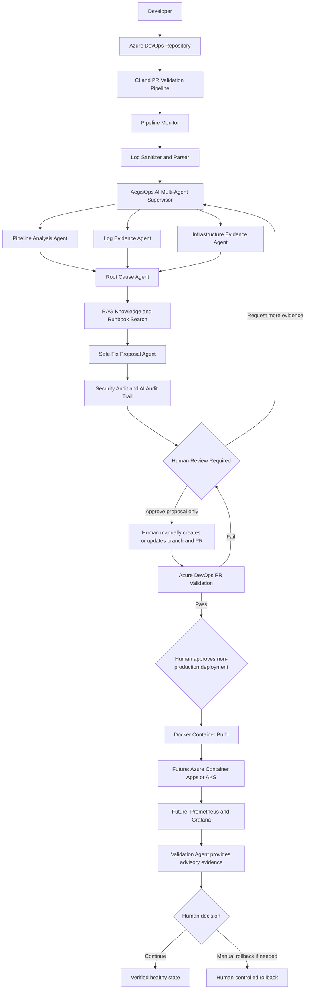
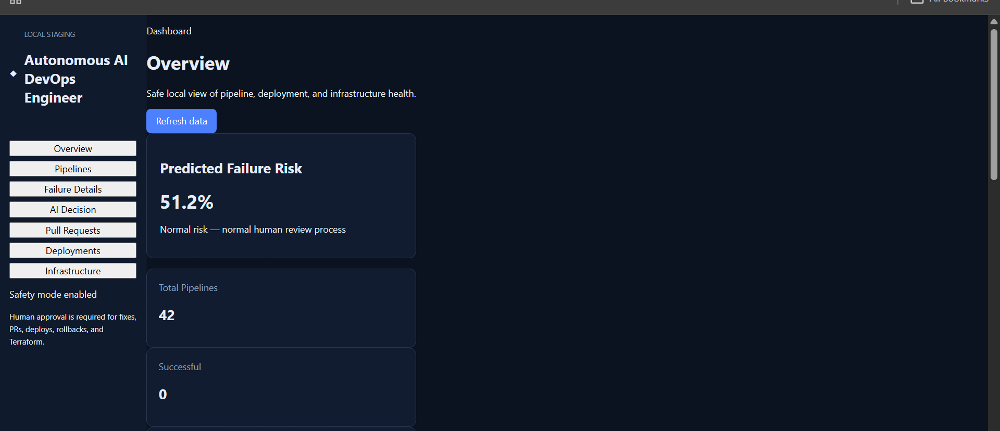
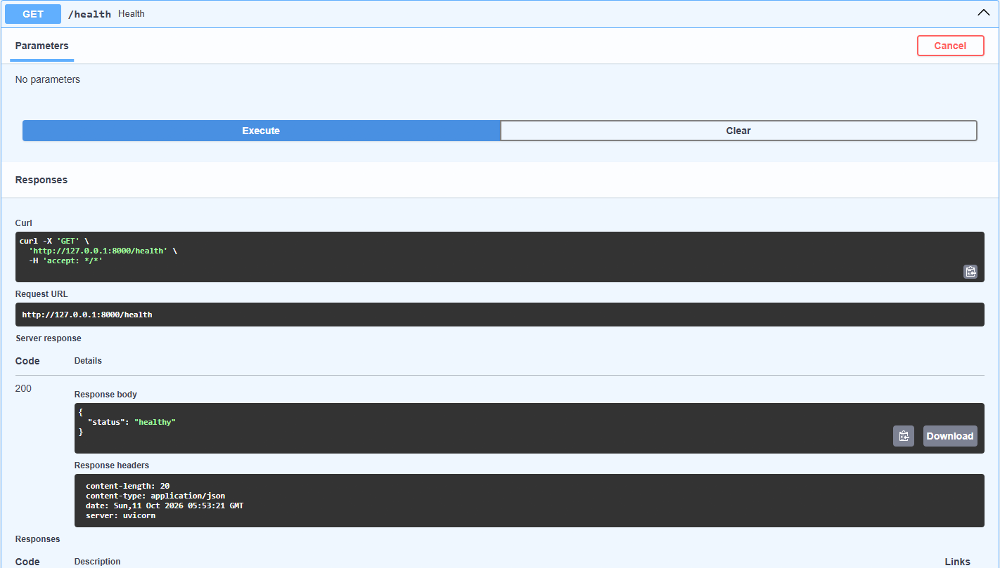
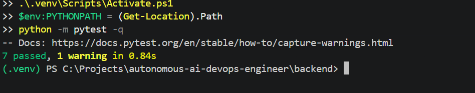
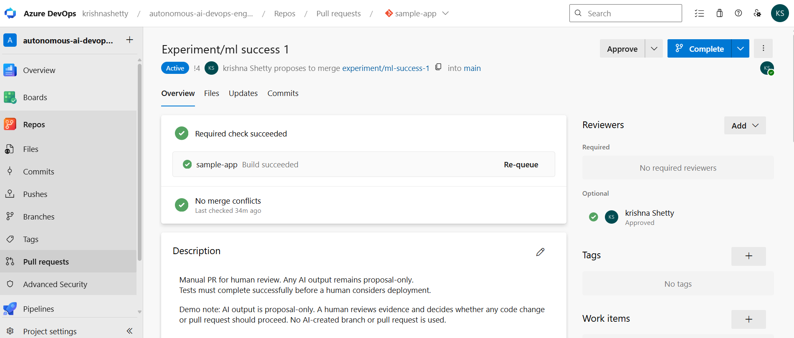

# AegisOps AI

## Autonomous Multi-Agent DevOps Engineering Platform

AegisOps AI is a human-controlled, multi-agent DevOps platform that helps teams detect CI/CD failures, redact sensitive log data, analyze probable root causes, predict failure risk, and produce safe fix proposals for human review.

> “Autonomous” applies only to analysis, evidence collection, and advisory proposals. Humans retain control over pull requests, deployments, infrastructure changes, and rollbacks.

## Problem Statement

CI/CD failures can be slow to detect and difficult to investigate. Build logs are often large, unclear, and may contain sensitive information. Fully automated remediation is unsafe because an AI system should not independently create pull requests, deploy code, modify infrastructure, or roll back production systems.

## Solution

AegisOps AI provides a secure, human-controlled DevOps workflow:

- Monitors and records safe build-risk predictions.
- Parses pipeline logs and redacts secret-like values.
- Coordinates specialized DevOps analysis agents.
- Produces evidence-supported root-cause analysis.
- Searches safe historical knowledge and runbook context.
- Generates advisory fix proposals only.
- Stores security and AI audit records.
- Requires human approval before any code or infrastructure action.

## Architecture



## Key Features

- Multi-agent DevOps analysis workflow.
- CI/CD failure-risk prediction.
- Safe local decision records.
- Pipeline-log parsing and context limits.
- Sensitive-data redaction before storage or display.
- AI-assisted root-cause analysis.
- RAG-supported runbook and historical-evidence search.
- Human-reviewed fix proposals.
- Security audit trail.
- AI audit trail.
- API request validation.
- Rate-limit protection.
- Role-based access-control design.
- Azure DevOps pull-request validation.

## Safety Boundaries

AegisOps AI is intentionally designed with strict safety boundaries:

- AI does not create Git branches.
- AI does not create pull requests.
- AI does not deploy applications.
- AI does not perform rollbacks.
- AI does not run Terraform.
- AI does not modify Kubernetes resources.
- AI does not expose secrets to the React dashboard.
- AI proposals remain advisory until reviewed by a human.

The following automation flags remain disabled:

```text
ALLOW_AI_BRANCH_CREATION=false
ALLOW_AI_PULL_REQUEST_CREATION=false
ALLOW_AUTOMATED_DEPLOYMENT=false
ALLOW_AUTOMATED_ROLLBACK=false
ALLOW_TERRAFORM=false
ALLOW_KUBERNETES_MUTATIONS=false
```

## Screenshots

> Screenshots must never contain passwords, Azure PATs, API keys, database URLs, bearer tokens, `.env` values, or raw production logs.

### Dashboard



### FastAPI API Documentation



### Local Test Results



### Azure DevOps PR Validation



## Local Development Setup

### Prerequisites

- Python
- Node.js and npm
- Docker Desktop
- PostgreSQL through Docker Compose
- Azure DevOps account for repository and PR validation

### Start PostgreSQL

From the project workspace folder:

```powershell
cd C:\Projects\autonomous-ai-devops-engineer
docker compose up -d postgres
```

### Start the FastAPI Backend

```powershell
cd C:\Projects\autonomous-ai-devops-engineer\backend
.\.venv\Scripts\Activate.ps1
$env:PYTHONPATH = (Get-Location).Path
uvicorn app.main:app --host 127.0.0.1 --port 8000 --reload
```

Open API documentation:

```text
http://127.0.0.1:8000/docs
```

### Start the React Dashboard

```powershell
cd C:\Projects\autonomous-ai-devops-engineer\frontend\dashboard
npm install
npm run dev
```

Open the dashboard:

```text
http://localhost:5173
```

## Testing

Run the complete local test suite:

```powershell
cd C:\Projects\autonomous-ai-devops-engineer\backend
.\.venv\Scripts\Activate.ps1
$env:PYTHONPATH = (Get-Location).Path
python -m pytest -q --cov=app --cov-report=term-missing
```

The test strategy includes:

- Unit tests for log parsing.
- Unit tests for sensitive-data redaction.
- Unit tests for decision-status transitions.
- AI response-schema tests.
- Fake, redacted AI failure scenarios.
- API validation checks.
- Manual Azure DevOps PR-validation testing.

## AI Safety Testing

AegisOps AI uses only fake and redacted log data for local AI testing.

Scenarios include:

- Dependency-resolution failure.
- Unsupported or insufficient evidence.
- Ambiguous network failure.
- Multiple independent errors.
- Huge-log context limiting.
- Secret-like text redaction.

AI output must use cautious language when evidence is incomplete or ambiguous. A proposed fix is never treated as a verified repair until a human approves and validates it.

## Audit Trail

Important actions are recorded with safe metadata, including:

- Timestamp
- Agent name
- Input source
- Decision summary
- Confidence
- Action
- Result
- Human approval status
- Azure build ID or local decision ID where available

Audit records must not contain raw logs, secrets, passwords, bearer tokens, Azure PATs, API keys, database URLs, or prompts.

## Research Metrics

The project defines the following research metrics:

- Mean Time To Detect (MTTD)
- Mean Time To Repair (MTTR)
- Failure prediction accuracy
- AI root-cause accuracy
- Human-tested fix success rate
- Manual rollback success rate

Fake local demonstrations are classified as `demo` data and are never mixed with approved `test` or genuine `real` incident results.

## Project Status

| Area | Status |
| --- | --- |
| Local React dashboard | Complete |
| Local FastAPI backend | Complete |
| Docker PostgreSQL | Complete |
| Security controls | Complete |
| Log redaction | Complete |
| AI safety scenarios | Complete |
| Audit-trail design | Complete |
| Azure DevOps PR validation | Demonstrated |
| Cloud deployment | Pending approved budget |
| Azure Container Apps / AKS | Pending approved budget |
| Prometheus / Grafana | Future work |

## Future Improvements

- Azure Container Apps deployment.
- Azure Key Vault managed-secret integration.
- Managed PostgreSQL with private networking.
- Optional AKS demonstration.
- Prometheus and Grafana monitoring.
- Entra/OIDC sign-in for public or team deployment.
- Additional approved non-production test incidents for research metrics.

## License

This project is intended for educational, research, and portfolio demonstration purposes.