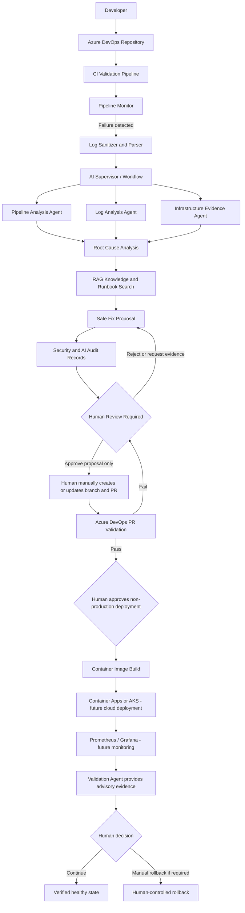

## Purpose

This architecture defines a human-controlled AI DevOps platform. AI detects, analyzes, and proposes safe actions. Humans retain control over pull requests, deployments, and rollbacks.

## Mandatory Safety Boundaries

- AI may analyze redacted logs and create text-only fix proposals.
- AI must not create Git branches or pull requests.
- AI must not deploy, roll back, run Terraform, or modify Kubernetes.
- Every proposed fix requires human review.
- Every production-like deployment requires a human approval outside the AI API.
- Every rollback is performed manually by a human.
- Secrets remain server-side only and are never displayed in React, logs, Git, Docker images, or documentation.

## Current Local Implementation Status

- [x] React dashboard and FastAPI backend run locally.
- [x] PostgreSQL runs locally through Docker.
- [x] Log sanitization and parser tests pass.
- [x] AI failure analysis uses fake, redacted test logs.
- [x] AI audit and security audit design implemented.
- [x] Azure DevOps PR validation demonstrated.
- [x] Human review remains required for proposed fixes.
- [x] Automated branch, PR, deployment, rollback, Terraform, and Kubernetes actions remain disabled.
- [ ] Cloud container deployment pending budget.
- [ ] Prometheus and Grafana deployment pending.
- [ ] Azure Container Apps or AKS deployment pending budget.

## Deployment Boundary

The current project is complete for local development, testing, and demonstration.

Future cloud deployment may use Azure DevOps, Azure Container Registry, Azure Container Apps or AKS, Azure Key Vault, and managed PostgreSQL. These cloud components are intentionally pending until an approved budget is available.